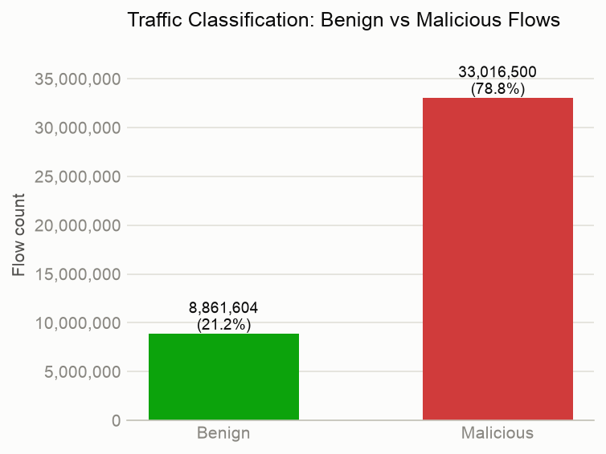
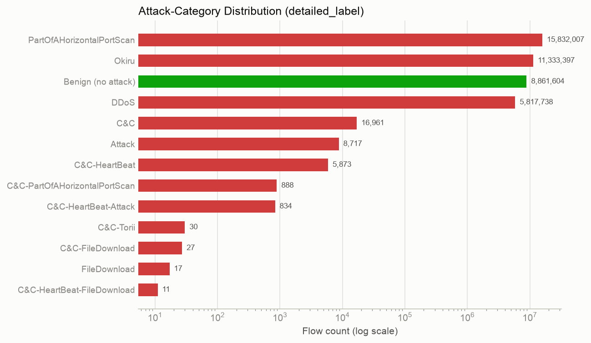
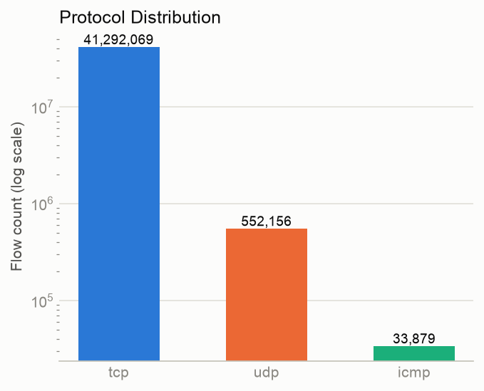
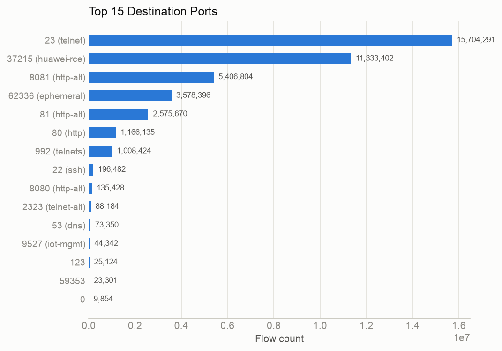
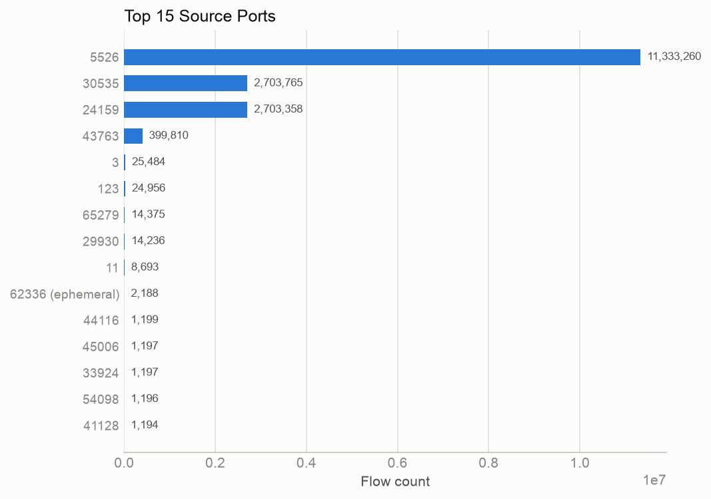
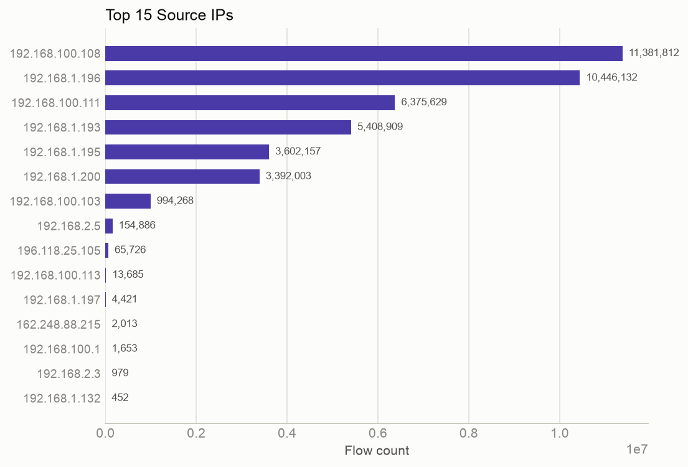
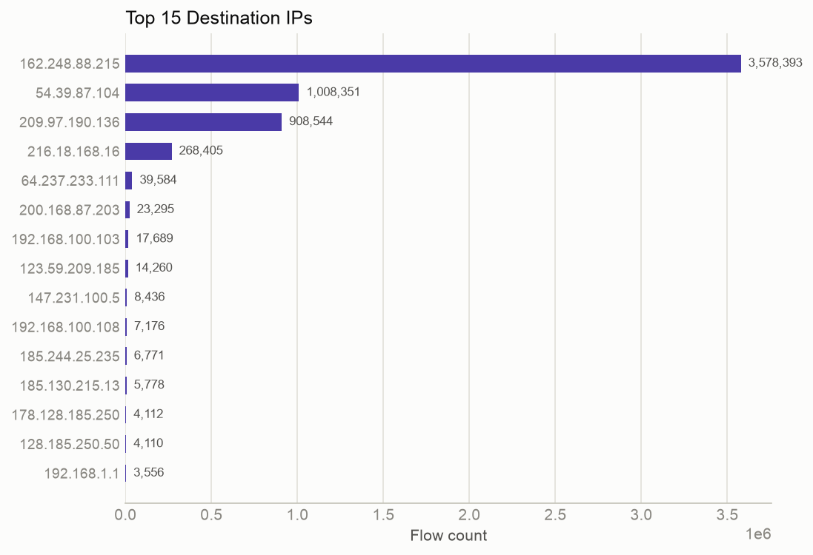
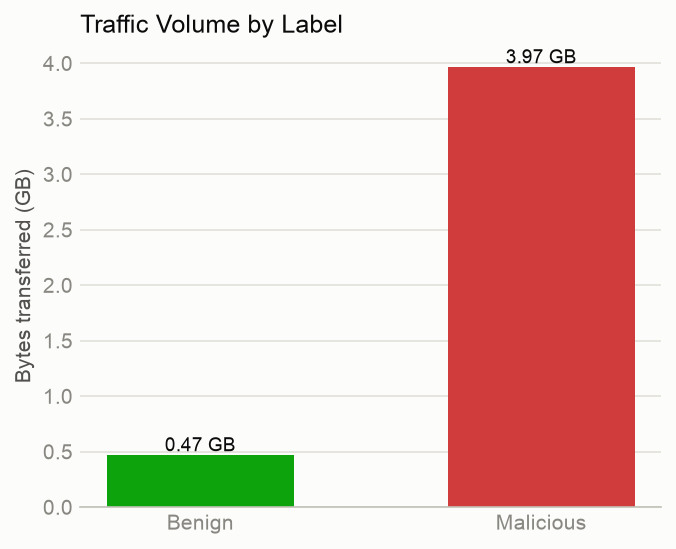
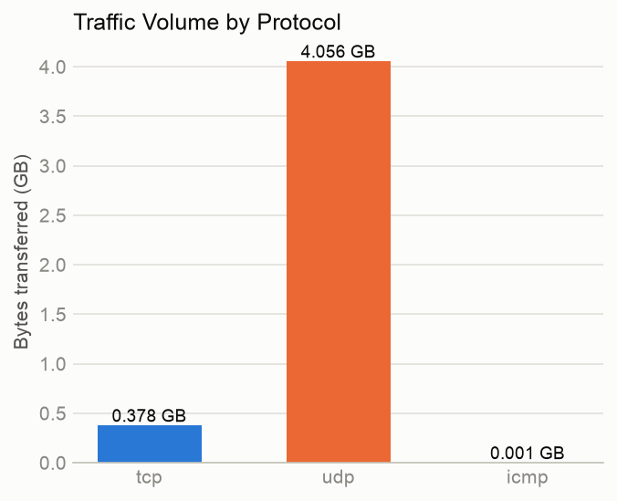
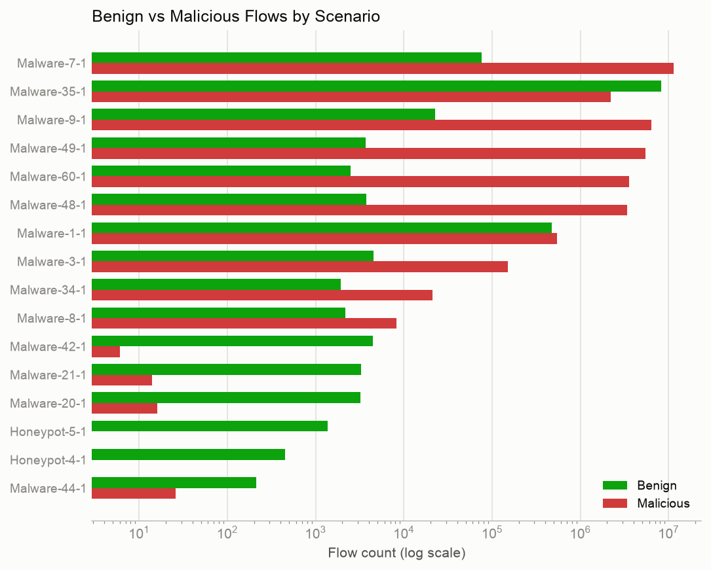

# Big Data Analytics for IoT Network Traffic and Malware Behaviour Using Hadoop MapReduce

**Project domain:** Big Data Analytics + IoT Security
**Dataset:** IoT-23 (Aposemat), "small" distribution
**Primary framework:** Apache Hadoop 3.2.4 (HDFS + YARN + MapReduce)
**Programming language:** Java (MapReduce), Python (preprocessing & visualization)

## 1. Problem Statement and Objectives

IoT devices generate continuous network traffic, some of it normal device behavior and some
of it malware activity — scanning, command-and-control (C&C) communication, or denial-of-service
flooding. At scale, this traffic cannot be analyzed manually. This project asks:

> **Can we use distributed data processing (Hadoop MapReduce) to analyze large volumes of
> labeled IoT network traffic and identify patterns associated with malicious activity?**

Objectives:
1. Store a multi-gigabyte slice of real, labeled IoT network traffic in HDFS.
2. Process it in parallel with Java MapReduce to compute traffic-classification, attack-category,
   protocol, port, IP, byte-volume, and scenario-comparison statistics.
3. Interpret the results as a security analyst would, and document Hadoop's execution behavior
   (mappers/reducers, job counters, timing) along the way.

This is a **label-based IoT network traffic analysis**, not a production intrusion-detection
system: it summarizes known-labeled traffic, and makes no claim to detect previously unseen
attacks.

## 2. Dataset Description

**IoT-23** (Stratosphere Laboratory / Avast AIC) is a labeled dataset of IoT network traffic
captured as Zeek (Bro) connection logs, with each flow labeled `Benign` or `Malicious` plus a
`detailed-label` attack category (`DDoS`, `C&C`, `PartOfAHorizontalPortScan`, `Okiru`, etc.).
The "small" distribution used here is a representative subset, originally ~8.7GB compressed.

**Scenario selection.** The full small archive extracts to ~44GB across 23 scenarios (3 clean
Honeypot captures + 20 malware captures, one malware family per scenario). Given a 4GB minimum
input-size requirement and the available disk budget on the development laptop, **16 of the 23
scenarios (~5.5GB raw, ~6.4GB after preprocessing, 41.9M flow records)** were selected to span 8
distinct malware families (Mirai, Gafgyt, Okiru, Torii, Trojan, Hakai, Muhstik, Hide-and-Seek)
plus both clean Honeypot captures. Full scenario list, field schema, and label dictionary are in
`docs/module1_data_dictionary.md`.

**Key parsing detail.** Every data row has 21 tab-separated fields even though the Zeek header
names 23 — `tunnel_parents`, `label`, and `detailed-label` are packed into the last tab field,
separated from each other by spaces rather than tabs. This is a quirk of IoT-23's labeling
script (verified on all 16 scenarios, 100% consistent), not data corruption, and the
preprocessing/MapReduce code parses around it explicitly.

## 3. System Architecture

```
IoT-23 raw Zeek logs (conn.log.labeled, 16 scenarios)
        |
        v
Python preprocessing (scripts/preprocess.py)
  - strip Zeek #-comment/header lines
  - parse 21-tab-field + 3-whitespace-subfield layout
  - normalize label casing, blank out "-" numeric placeholders
  - tag every row with its source scenario
        |
        v
data/processed/*.tsv  (16 files, ~6.4GB, 24 columns, 41.9M rows, 0 dropped)
        |
        v
HDFS  (/iot23/processed/, replication factor 1, single DataNode)
        |
        v
Java MapReduce (7 jobs, YARN-scheduled)  -->  /iot23/output/<job>/part-r-00000
        |
        v
Python + Matplotlib (scripts/visualize.py)  -->  docs/figures/*.png
```

The cluster is a **single-machine, pseudo-distributed Hadoop setup**: one NameNode, one
DataNode, one NodeManager (8 vCores / 8GB configured). It demonstrates HDFS storage, YARN job
scheduling, and MapReduce's split/shuffle/reduce model correctly, but does not involve multiple
physical machines, and the configured replication factor is 1 (a second physical replica is not
possible with a single DataNode).

## 4. Hadoop Implementation Notes

Two environment issues surfaced during setup and are documented here since they are the kind of
real operational problem a distributed-systems project is expected to encounter and resolve:

- **Port conflict.** HDFS's default NameNode port (9000) was already bound by an unrelated local
  process (`minio`). Fixed by moving `fs.defaultFS` to `hdfs://localhost:9820` in `core-site.xml`.
- **YARN disk-health check.** The NodeManager marked itself `UNHEALTHY` and refused to run any
  container, because its default local/log directories resolve under `/tmp`, which on this
  machine's macOS APFS volume layout sits on a volume that was over the default 90%
  disk-utilization health threshold (even though tens of GB were genuinely free — a quirk of how
  macOS reports per-volume capacity in a multi-volume APFS container). Fixed by redirecting
  `yarn.nodemanager.local-dirs`/`log-dirs` to a path under the Hadoop install directory and
  raising `yarn.nodemanager.disk-health-checker.max-disk-utilization-per-disk-percentage` to 98.

## 5. MapReduce Algorithms

All 7 jobs share a single-pass map → combine → reduce shape over the same input
(`/iot23/processed/`, 41.9M records) and a common parsing helper (`IotRecord.java`) that skips
header rows and malformed lines. Each job's mapper emits `(key, 1)` or `(key, bytes)`; a combiner
pre-aggregates per map task; the reducer sums.

| # | Job (class) | Map key | What it measures |
|---|---|---|---|
| 1 | `TrafficClassification` | `label` | Benign vs Malicious flow counts |
| 2 | `AttackCategoryDistribution` | `detailed_label` | Attack-category breakdown (`-` = benign) |
| 3 | `ProtocolDistribution` | `proto` | tcp/udp/icmp flow counts |
| 4 | `PortAnalysis` | `SRC:<port>` / `DST:<port>` | Most-used source & destination ports |
| 5 | `TrafficVolume` | `PROTO:<proto>` / `LABEL:<label>` | Total bytes transferred, two breakdowns |
| 6 | `IpAnalysis` | `SRC:<ip>` / `DST:<ip>` | Most-active source & destination hosts |
| 7 | `ScenarioComparison` | `<scenario>\|<label>` | Benign/malicious mix per capture scenario |

Example (job 1, mirroring the worked example from the project brief): input rows with
`label=Malicious` and `label=Benign` are mapped to `(Malicious, 1)` / `(Benign, 1)`; the reducer
sums each key to produce the two final counts shown in §6.1.

**Data-quality fix in job 5.** The raw `orig_bytes`/`resp_bytes` fields occasionally contain a
value Zeek cannot have legitimately measured (a known artifact on connections with
sequence-number gaps, `conn_state=OTH`) — in the worst case, 66GB of "payload" on a 97-packet
flow. `IotRecord.totalBytes()` treats an app-layer byte count as invalid whenever it exceeds the
corresponding IP-layer byte count for that side of the connection, which affected 65,540 of
41.9M rows (0.16%) and, left unfixed, inflated the entire volume sum to ~2.14 quadrillion bytes.
Details in `docs/module1_data_dictionary.md` §3b.

## 6. Results

### 6.1 Traffic classification
33,016,500 Malicious (78.8%) vs 8,861,604 Benign (21.2%) flows — expected, since the selected
scenarios are live malware captures, not a clean network baseline.


### 6.2 Attack-category distribution
Dominated by `PartOfAHorizontalPortScan` (15.8M), `Okiru` (11.3M), and `DDoS` (5.8M); all other
categories (various C&C forms, FileDownload) are 3-4 orders of magnitude smaller.


### 6.3 Protocol distribution
TCP: 41.3M (98.7%), UDP: 552K, ICMP: 34K.


### 6.4 Port analysis
Destination port 23 (Telnet, 15.7M flows) and port 37215 (a Huawei router RCE, CVE-2017-17215,
11.3M flows) dominate — signature Mirai-family propagation behavior.



### 6.5 IP analysis
A handful of infected `192.168.x.x` hosts generate the bulk of source traffic; destination side
is topped by `162.248.88.215` (3.58M flows, a DDoS target) with a long tail from horizontal
scanning.



### 6.6 Traffic volume
Malicious: 3.97GB vs Benign: 0.47GB. By protocol, UDP carries 4.06GB despite being only 1.3% of
flows by count — consistent with flood/amplification DDoS traffic (few, large, long-running
flows) versus the many small TCP scan probes that dominate by count.



### 6.7 Scenario comparison
Malicious flows outnumber benign in 13 of 16 scenarios, usually by 2-3 orders of magnitude.
Capture-35-1 is a notable exception (8.26M benign vs 2.19M malicious) — the opposite ratio of
every other malware scenario.


Full interpretation and discussion: `docs/module6_findings.md`.

## 7. Execution and Performance

All 7 jobs ran against the same 41.9M-record, ~6.4GB HDFS input on the single-node cluster:

| Job | Wall time (s) | Map input records | Map output records | Reduce output records |
|---|---|---|---|---|
| traffic_classification | 210 | 41,878,120 | 41,878,104 | 2 |
| attack_category | 174 | 41,878,120 | 41,878,104 | 13 |
| protocol | 200 | 41,878,120 | 41,878,104 | 3 |
| ports | 223 | 41,878,120 | 83,756,208 | 130,971 |
| volume | 297 | 41,878,120 | 83,756,208 | 5 |
| ips | 243 | 41,878,120 | 83,756,208 | 27,987,624 |
| scenario_comparison | 192 | 41,878,120 | 41,878,104 | 30 |

(Map input records exceeds map output records by exactly 16 — the 16 per-scenario header rows
that `TextInputFormat` reads but `IotRecord.parse()` filters out.) Jobs that emit two records
per input row (ports, volume, ips) take noticeably longer and move roughly double the shuffle
data, as expected. The `ips` job's 27.9M distinct reduce keys is the practical ceiling for this
style of per-entity counting — a direct consequence of horizontal port scanning touching a huge
number of distinct destination IPs.

All jobs were run via `hadoop jar` under YARN and are visible as completed applications in the
ResourceManager UI (`http://localhost:8088`) and JobHistory server; HDFS content is browsable via
the NameNode UI (`http://localhost:9870`).

## 8. Limitations

- **Single-node pseudo-distributed cluster.** All conclusions about "distributed processing" are
  architectural (HDFS splits, YARN container scheduling, map/shuffle/reduce) rather than a
  demonstration of multi-machine scaling. Replication factor is 1 by necessity.
- **Scenario subset, not the full dataset.** 16 of 23 available small-distribution scenarios were
  used (and none of the much larger full-distribution captures), chosen for disk-space and time
  constraints. Findings describe this subset, not all of IoT-23.
- **Label-based analysis only.** The project summarizes already-labeled traffic; it does not
  build or evaluate a classifier and makes no claim about detecting unseen attacks.
- **Known data-quality artifact.** A small fraction (0.16%) of raw Zeek rows have an invalid
  byte-count field; this is explicitly filtered in the volume job (§5) but is worth noting as a
  property of the source data, not of the pipeline.

## 9. Conclusion

Across 41.9M labeled IoT network flows, Hadoop MapReduce reproduced a clear, interpretable
picture of IoT botnet behavior: traffic is overwhelmingly reconnaissance (port scanning) and
flooding (DDoS) rather than stealthy C&C, concentrated on a small number of classic IoT
attack-surface ports (Telnet, a router RCE, HTTP management interfaces), and highly uneven across
capture scenarios. The project demonstrates the full pipeline a BDA system is expected to show —
HDFS storage, YARN-scheduled Java MapReduce jobs with mapper/combiner/reducer stages, and
derived analytics turned into interpretable graphs — while surfacing and resolving real
environment issues (port conflicts, disk-health thresholds, raw-data quality) along the way.

## 10. References

- Stratosphere Laboratory, *Aposemat IoT-23: A Labeled Dataset with Malicious and Benign IoT
  Network Traffic*, Czech Technical University.
- Zeek Network Security Monitor documentation (connection log / `conn.log` fields).
- Apache Hadoop 3.2.4 documentation (HDFS, YARN, MapReduce).
- Project working documents: `docs/module1_data_dictionary.md`,
  `docs/module2_preprocessing_summary.md`, `docs/module5_performance.md`,
  `docs/module6_findings.md`.
