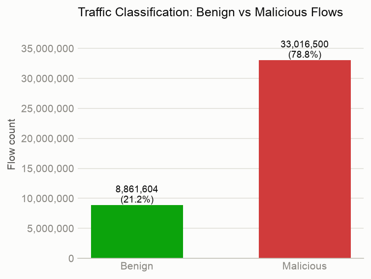
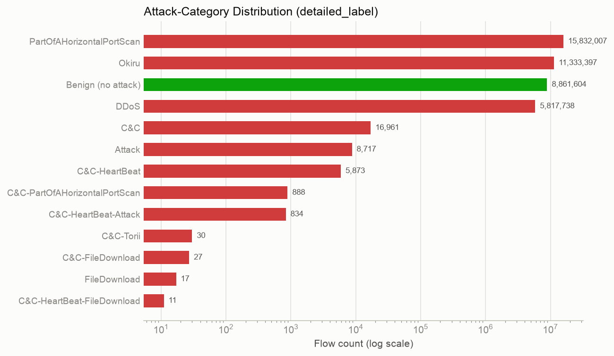
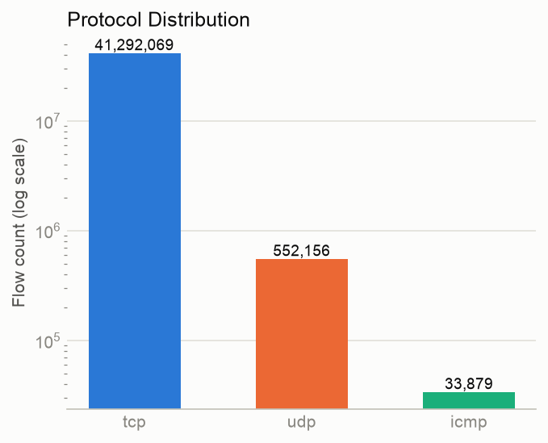
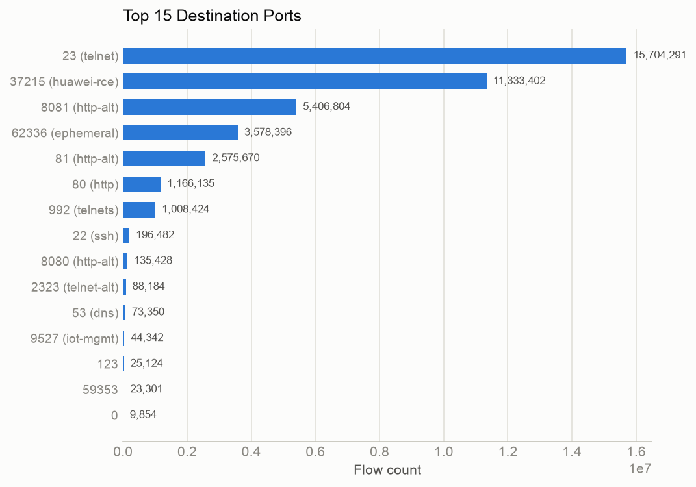
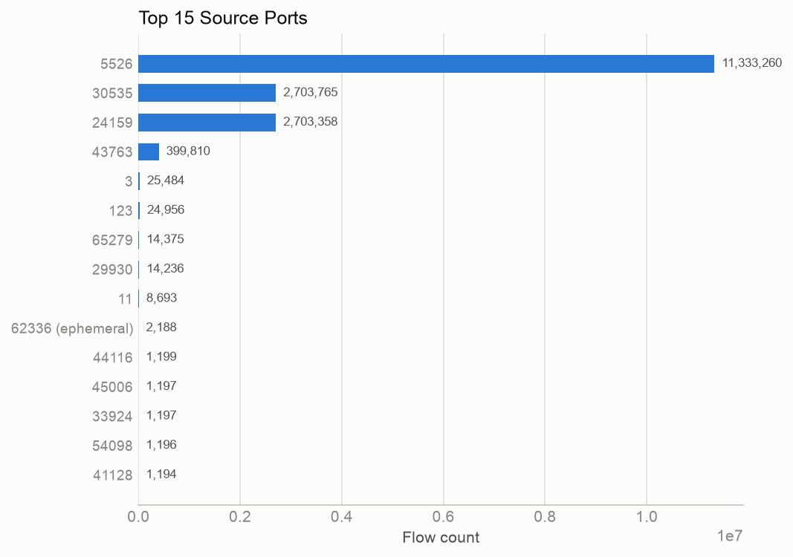
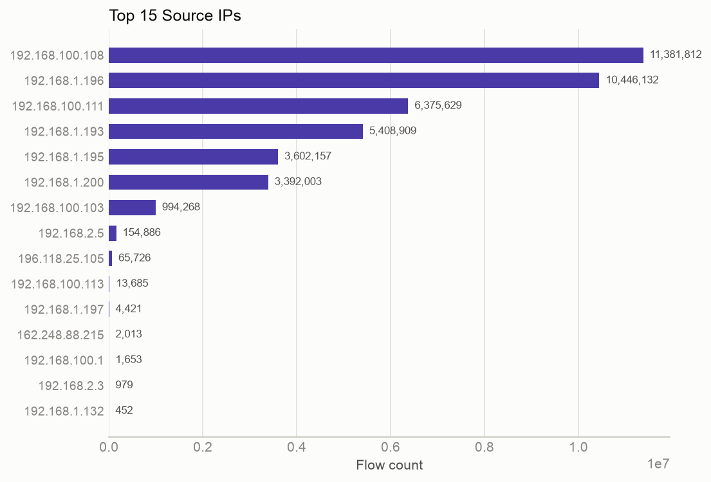
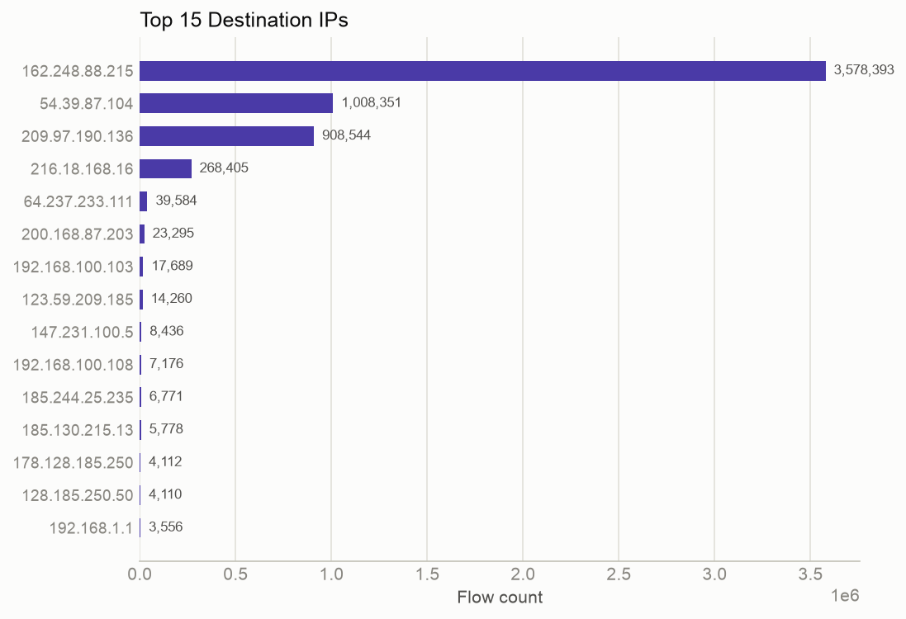
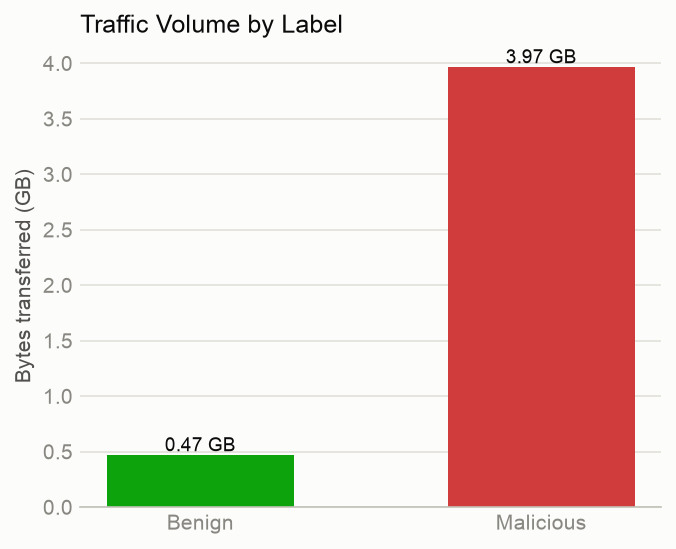
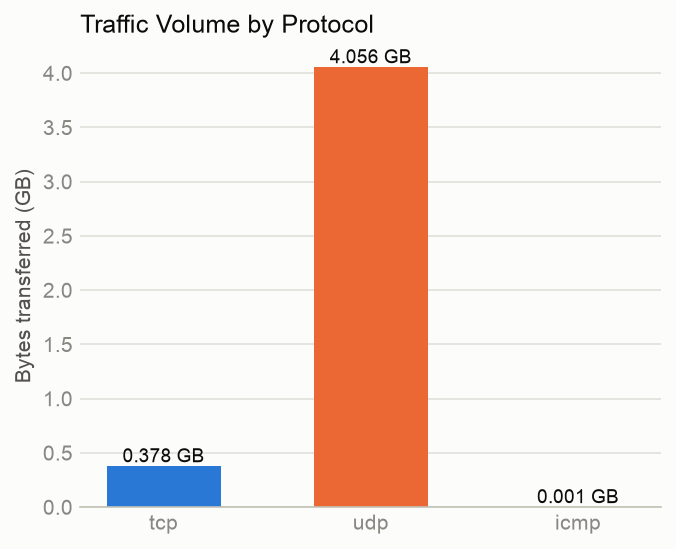
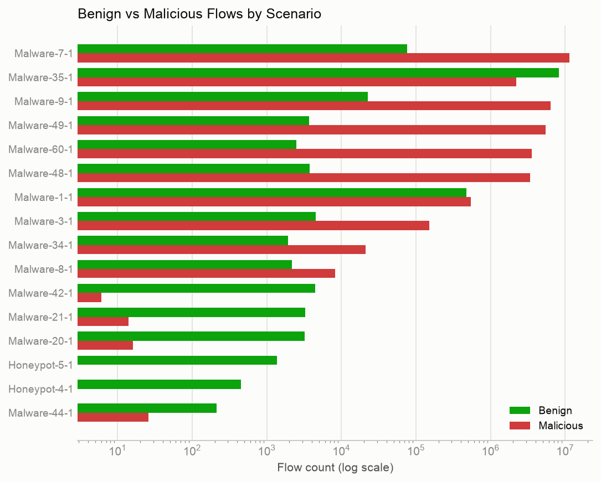

# Module 6 — Visualization and Interpretation

All figures below were generated by `scripts/visualize.py` from the Module 4 MapReduce
outputs (`data/output/*.tsv`, pulled from `/iot23/output/` in HDFS). Figures are in
`docs/figures/`.

## 1. Traffic classification

41.9M flows total: **78.8% malicious, 21.2% benign**. This is expected and by design — IoT-23's
malware-capture scenarios run a live-infected IoT device for an extended period, so most
captured traffic is the malware's own scanning/C&C/DDoS activity rather than normal device
use. It is not representative of a healthy network's baseline traffic mix.

## 2. Attack-category distribution

Within the malicious flows, three behaviors dominate overwhelmingly over everything else:
**PartOfAHorizontalPortScan** (15.8M, 48% of all malicious flows), **Okiru** (11.3M, a
Mirai-variant's own C&C protocol label), and **DDoS** (5.8M). Stealthier categories —
`C&C`, `C&C-HeartBeat`, `FileDownload` and their combinations — are each under 20K flows,
3-4 orders of magnitude smaller. This matches the expected shape of IoT botnet traffic: the
bot spends the overwhelming majority of its time scanning for the next victim or flooding a
DDoS target, and only a tiny fraction of flows are the comparatively rare "check in with C&C /
receive a new binary" events.

## 3. Protocol distribution

TCP dominates (41.3M flows, 98.7%) over UDP (552K) and ICMP (34K). This follows directly from
§2: horizontal port scanning and Telnet/HTTP-based exploitation are TCP-based, so the
dominant attack behaviors inflate the TCP count. UDP's share, while small by flow count, carries
disproportionate byte volume (§6) — consistent with UDP being the reflection/amplification
transport for DDoS.

## 4. Port analysis

Destination port 23 (Telnet) is the single most-targeted port (15.7M flows) — textbook IoT
botnet behavior, since Mirai-family malware propagates by brute-forcing default Telnet
credentials on other devices. Port 37215 (11.3M flows) is notable: this is the
Huawei HG532 router remote-code-execution port (CVE-2017-17215), which several Mirai variants
specifically scan for. Ports 8081/81/80/8080 (HTTP/HTTP-alt) and 992/22 (Telnet-S/SSH) round
out the picture — all classic IoT device management surfaces. On the source-port side, a
handful of fixed ports (5526, 30535, 24159) carry millions of flows each, which indicates a
small number of infected devices repeatedly using the same ephemeral/bound source port across
many scan attempts rather than randomizing per-connection.

## 5. IP analysis

Source-side activity concentrates in a handful of `192.168.x.x` addresses — these are the
captured IoT honeypot/victim devices in each scenario, each generating millions of outbound
scan/attack flows once infected. On the destination side, `162.248.88.215` alone receives
3.58M flows (matches Capture-60-1's DDoS target almost exactly — see §7), with the next three
IPs (`54.39.87.104`, `209.97.190.136`, `216.18.168.16`) likely other DDoS targets or C&C
servers. The long tail of low-count destination IPs reflects horizontal port-scan behavior:
one probe each to a huge number of distinct hosts.

## 6. Traffic volume

Malicious traffic carries ~3.97GB vs benign's ~0.47GB — malicious flows are both more numerous
*and* heavier on average. By protocol, UDP (4.06GB) carries far more bytes than its flow count
would suggest (0.552M flows, 1.3% of all flows, but 91% of all bytes) — consistent with
UDP flood/amplification DDoS traffic, where each flow is large and long-running, versus the
many small single-packet TCP SYN scan probes that dominate flow *count* but not *volume*.

**Data-quality note**: a small number of raw Zeek records (65,540 of 41.9M, 0.16%, all with
`conn_state=OTH`) report an `orig_bytes`/`resp_bytes` value that is physically impossible
(exceeding the IP-layer byte count for the same connection — e.g. 66GB of payload from a
97-packet flow). This is a known Zeek artifact on connections with sequence-number gaps, not a
pipeline bug; see `docs/module1_data_dictionary.md` §3b. The MapReduce `TrafficVolume` job
treats these as invalid (zeroes the corrupted field) so one bogus row cannot dominate a sum
over millions of flows.

## 7. Scenario comparison

Malicious flows outnumber benign in 13 of the 16 scenarios, often by 2-3 orders of magnitude
(e.g. Capture-9-1: 6.36M malicious vs 22.5K benign). The two Honeypot captures are, as
expected, 100% benign (they contain no malware). **Capture-35-1 is the one notable outlier**:
8.26M benign flows vs only 2.19M malicious — the opposite ratio of every other malware
scenario. This is worth a closer look in the final report; it suggests either a longer clean
capture period before infection took hold, or a different device/workload in that capture
generating heavy legitimate traffic alongside the Mirai activity.

## Summary of key findings for the report

1. IoT-23 malware captures are dominated by reconnaissance (port scanning) and flooding
   (DDoS), not stealthy C&C traffic — by flow count, >94% of malicious activity is scan/DDoS.
2. Telnet (port 23) and a specific router RCE (port 37215) are the two most-targeted services,
   confirming these captures are classic Mirai-family IoT botnet behavior.
3. Flow *count* and traffic *volume* tell different stories: TCP dominates by count (scanning),
   UDP dominates by volume (flooding) — a useful illustration of why both metrics matter.
4. Benign/malicious mix varies enormously by scenario (Capture-35-1 vs the rest), showing that
   a single aggregate statistic across scenarios can hide very different underlying behavior.
